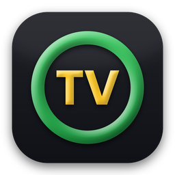

# TorrentVision

**Torrent para todos.**

Aplicación de escritorio para bajar, organizar y ver películas, series y videos por categorías, con una app para el celular que la maneja desde el sillón.

*TVon es el nombre del proyecto en el código: el programa, la carpeta de datos y el paquete de la app siguen llamándose así por dentro.*

## Descargar

**[⬇ TorrentVision-Setup-1.10.25.exe](https://github.com/facuperma/TVon-App-de-escritorio-para-organizar-y-ver-videos/raw/main/instalador/TorrentVision-Setup-1.10.25.exe)** (90 MB) — para la PC (Windows 10/11, 64 bits)

**[⬇ TorrentVision-Android-1.1.29.apk](https://github.com/facuperma/TVon-App-de-escritorio-para-organizar-y-ver-videos/raw/main/instalador/TorrentVision-Android-1.1.29.apk)** (3 MB) — app para el celular (Android 8 o más nuevo): ver más abajo, en [📱 ON](#-on-manejar-torrentvision-desde-el-celular)

También desde la **[página de TorrentVision](https://facuperma.github.io/TVon-App-de-escritorio-para-organizar-y-ver-videos/#bajar)**: en la compu muestra un QR para bajar la app en el celular.

**¿Es el original?** En la [página de descargas](https://facuperma.github.io/TVon-App-de-escritorio-para-organizar-y-ver-videos/#bajar), el botón **🔒 Bajar verificado** lo comprueba solo: baja el archivo, calcula su huella SHA-256 y la compara con la publicada en [`instalador/SHA256.txt`](instalador/SHA256.txt); solo si coincide te deja guardarlo, y si no, te avisa que no lo instales. A mano: `certutil -hashfile TorrentVision-Setup-1.10.25.exe SHA256` (en PowerShell: `Get-FileHash`) y compará con `SHA256.txt`.

El instalador de la PC: ejecutalo y seguí los pasos: no hace falta instalar Python ni nada más, ni permisos de administrador. Crea accesos directos en el menú Inicio (y en el Escritorio, si lo elegís) y se desinstala desde *Configuración → Aplicaciones*.

Como el instalador no está firmado digitalmente, Windows puede mostrar «Windows protegió su PC»: tocá **Más información → Ejecutar de todas formas**.

La biblioteca y la configuración se guardan en `%LOCALAPPDATA%\TVon`.

## Desde el código fuente

```
python -m venv .venv
.venv\Scripts\pip install -r requirements.txt
```

Doble clic en `TVon.bat` o `.venv\Scripts\python main.py` (usa la misma biblioteca que la versión instalada, en `%LOCALAPPDATA%\TVon`).

Para generar el instalador: `.venv\Scripts\pip install pyinstaller` y `.venv\Scripts\python empaquetado\construir.py` (requiere [Inno Setup 6](https://jrsoftware.org/isinfo.php)). Queda en `compilado\`. El script baja [aria2](https://aria2.github.io) (motor de torrents) a `organizador\bin\` si no está, y verifica su huella.

## Uso

- **Agregar archivos / carpeta** (o arrastrarlos a la ventana). Las carpetas se recorren con subcarpetas.
- Los archivos no se copian ni se mueven: solo se guarda su ruta en `biblioteca.db`.
- Panel izquierdo: filtrar por Todos / Videos / Imágenes / Sin categoría o por una categoría.
- Seleccioná varios archivos arrastrando el mouse (o con Ctrl/Shift + clic) y con **clic derecho** asignalos a una categoría, quitalos de una o creá una nueva. En «Sin categoría» desaparecen al asignarlos.
- Panel derecho: visor y las categorías del archivo (se cambian con **✎ Editar**). La ruta se copia desde la lista: clic derecho → **📋 Copiar ruta** o **Ctrl+C** (con varios seleccionados, una ruta por línea).
- La categoría **★ Favoritos** viene incluida y siempre está primera: sumá archivos con clic derecho → *Agregar a Favoritos*.
- Un clic en un video muestra una **vista previa** (un cuadro del video, sin sonido): se reproduce con clic sobre la imagen, ▶ o Espacio, siempre desde el principio.
- Al elegir una categoría se selecciona su primer video en vista previa, sin empezar a reproducirse.
- **⚡ Categoría rápida** (a la derecha de la cantidad de archivos, con algo seleccionado): crea la categoría con el título del video y mueve el video con sus subtítulos a `Videos\Peliculas\<título>`. **+ Nueva categoría** con archivos seleccionados hace lo mismo con el nombre que elijas.
- Nombres lindos: la lista muestra el título limpio, como la categoría rápida, con el capítulo, el año y la calidad si el archivo los trae («Breaking.Bad.S01E02.720p.WEB-DL.mkv» → «Breaking Bad · S01E02 · 720p», «The.Matrix.1999.1080p.BluRay.mkv» → «The Matrix (1999) · 1080p»). El archivo en el disco no se toca; su ruta aparece al pasar el mouse.
- Columnas de la lista (**Nombre** y **Carpeta**): se achican, agrandan y mueven arrastrando; clic derecho en la cabecera para ocultar o mostrar cada una. TorrentVision recuerda cómo las dejaste. La carpeta es un vínculo: tocarla abre el Explorador con el video marcado.
- Volumen: el porcentaje se ve al lado de la barra y, al moverlo, grande sobre el video. TorrentVision arranca al 50 %.
- Menú superior: **Archivo**, **Vista** (ocultar paneles, pantalla completa), **Configuración**, **Acerca de** (versión) y **Reportar un bug** (abre un issue en GitHub con la versión ya completa).
- Botones **🌐 Películas** ([ext.to](https://ext.to/)) y **🌐 Subtítulos** ([subdivx.com](https://subdivx.com/)) en la barra superior: abren esas páginas en el navegador. Lo que descargues ahí termina en Descargas y TorrentVision lo mueve solo a Videos.

### 📱 ON: manejar TorrentVision desde el celular

Botón **📱 ON** en la barra superior (o *Configuración → ON*; se pone verde mientras está encendido): abre la ventana de ON, donde se ve si está en OFF y se enciende para mostrar el código QR; escanealo con el celular (Android, en Chrome). El celular y la PC tienen que estar en la misma red wifi. Para tenerlo como app: en Chrome, menú ⋮ → *Agregar a la pantalla principal*.

#### App para Android (recomendada)

**[⬇ TorrentVision-Android-1.1.29.apk](https://github.com/facuperma/TVon-App-de-escritorio-para-organizar-y-ver-videos/raw/main/instalador/TorrentVision-Android-1.1.29.apk)** (3 MB, Android 8 o más nuevo). **O escaneá el QR de la ventana ON con la cámara del celular:** la página que abre ofrece *⬇ Descargar la app* (lleva a la [página de descargas](https://facuperma.github.io/TVon-App-de-escritorio-para-organizar-y-ver-videos/#bajar); sin internet, se baja desde tu PC), *📲 Abrir la app y conectar* (ya vinculada, sin escanear de nuevo) o **🌐 usarlo en el navegador, sin instalar nada**: la página tiene Control (con touchpad y el teclado que se abre solo al hacer clic en un campo de texto), Biblioteca, Cola, subtítulos, Tele (Chromecast), Mouse y Pantalla. También podés bajarla de acá, en el celular, y abrirla; Android pide permiso para *instalar apps de origen desconocido* (al navegador o a Archivos): permitilo solo para esto. Después tocá **📷 Escanear el código QR** con la ventana de ON abierta en la PC.

Si tenías la app 1.1.0, desinstalala antes de instalar la 1.1.3 (cambió la firma) y volvé a escanear el código QR. Desde la 1.1.1 se actualiza encima, sin volver a vincular.

Hace todo lo de la versión web (reproductor, subtítulos, cola, biblioteca, categorías, torrents, dominio público, mouse, teclado en vivo y pantalla de la PC) y además:

- **Sin el aviso «La conexión no es privada»:** el QR trae la huella del certificado de la PC y la app solo acepta ese certificado (*certificate pinning*). Si alguien en la red se hace pasar por la PC, la app corta. Con un TorrentVision anterior (QR sin huella), la app muestra la huella para compararla con la de la ventana ON.
- **Sesión cifrada en el celular** con el Android Keystore, sin copias de seguridad en la nube.
- **Pantalla de la PC más fluida**: decodificación nativa, sin acumular demora; pellizcar hace zoom, ⛶ la pone a pantalla completa acostada.
- **🏠 Inicio, como Jellyfin:** las películas y series de la PC con póster, sinopsis, géneros y puntaje; *Seguir viendo*, *A continuación* (el capítulo que sigue), *Agregadas hace poco* y Favoritos; filtros por género y orden. Las series se agrupan solas por temporada.
- **Ver en el celular:** tocá una película y *📱 Ver en el celular*: llega por la misma conexión cifrada, con subtítulos y siguiendo desde donde quedaste (en la PC o en el celular: el progreso es uno solo). Si el celular no puede reproducir el sonido o el video, la PC lo convierte mientras lo ves (hace falta ffmpeg: `winget install Gyan.FFmpeg`).
- **Links magnet:** tocá uno en el navegador (o *Compartir → TorrentVision*) y va directo a la PC.
- **Subtítulos:** en *Agregar → 💬 Subtítulo* pegá el link del .srt o .zip (lo baja la PC) o mandá el archivo que bajaste en el celular: llega a Descargas de la PC y se pone solo junto a su película o capítulo.
- **Botones de volumen** del celular → volumen de TorrentVision (en Reproductor; se apaga en *Más*).
- **Se vincula una sola vez:** el celular recuerda la PC (sesión cifrada con el Keystore de Android) y se reconecta solo después de reiniciar TorrentVision o la PC. Si el router le dio otra IP a la PC, la app la vuelve a encontrar en la wifi (y comprueba que sea el mismo certificado). Queda como **dispositivo de confianza** hasta que lo desvincules desde la PC; solo se olvida si pasa **un año sin usarse** (cada uso lo renueva). Los celulares nuevos siguen necesitando el QR de un solo uso. Con celulares vinculados, ON se enciende solo al abrir TorrentVision (salvo que lo apagues en *Encender ON cada vez que se abre TorrentVision*).
- **Vincular sin QR:** en la app, *📡 Vincular sin QR*: busca la PC en la wifi y le pide permiso. En la PC aparece un cartel con un **código de 6 números**; si es el mismo que muestra el celular, tocá *Permitir* (si alguien en la wifi se hiciera pasar por tu PC, los códigos no coincidirían).
- Casa y Tailscale: escaneá los dos QR (*Más → Agregar otra conexión*) y la app usa sola la que ande.

Para compilarla: JDK 17 y Android SDK 35; en `android\`, `gradlew assembleRelease` (firma con `android\firma.properties`, que no está en el repositorio).

- **Reproductor:** play/pausa, saltos de 5 y 15 s, barra de tiempo, volumen, siguiente capítulo o de la cola, anterior/siguiente de la lista, pantalla completa, *Apagar al terminar* (y cancelar la cuenta para apagar). Muestra lo que se está viendo.
- **Subtítulos:** elegir archivo o pista, desactivarlos, retraso, tamaño y buscar en OpenSubtitles.
- **Cola:** ver, reproducir uno ya, quitar o vaciar.
- **Biblioteca:** buscar; una sección **Categorías** con una tarjeta por categoría (amarilla si tiene algo por ver, verde si ya la viste, y las vistas en un grupo desplegable; manteniéndola apretada se marca vista o se le saca el amarillo); reproducir, encolar, Favoritos, asignar o quitar categorías, crear, renombrar o borrar categorías, *Categoría con el título*, abrir en ventana aparte, quitar de la biblioteca o mandar a la Papelera. Manteniendo apretado se eligen varios.
- **Agregar película:** pegás un **link magnet** y la PC lo baja con 🧲 Torrents (progreso, pausar, reanudar, cancelar); además, películas de dominio público: buscar, ordenar, descargar, la cola de descargas y la descarga automática.
- **Mouse:** el celular como touchpad, sin mirar la pantalla (ideal con la PC conectada a la tele): deslizar = mover el puntero, tocar = clic, tocar con dos dedos = clic derecho, deslizar con dos dedos = rueda. Botones **Izquierdo** y **Derecho** (manteniendo el izquierdo y deslizando se arrastra; 🔒 lo deja apretado) y velocidad ajustable. El touchpad también está en **▶ Control**, entre los controles del video y la Tele/Cola, así manejás todo sin cambiar de pestaña.
- **Teclado en vivo:** lo que escribís en el celular aparece en la PC letra por letra, con tildes, ñ, emojis y el autocorrector de Android. Si hacés clic en un campo de texto de la PC (un buscador, un chat, Word…), el teclado del celular **se abre solo**. También hay modo *Escribir y enviar* y teclas especiales (Enter, Esc, flechas, Alt+Tab, Win, Ctrl+C/V, volumen…).
- **Pantalla:** si hace falta, ves la pantalla de la PC en el celular y la manejás con el dedo: tocar = clic, dos toques = doble clic, mantener = clic derecho, deslizar = rueda, o el modo *Arrastrar*. Con teclado, teclas especiales (Enter, Esc, flechas, Alt+Tab…) y volumen de Windows. Calidad *Fluida* (25 cuadros por segundo), *Normal* (15) o *Nítida* (10); solo se muestran cuadros completos, sin cortes. Mientras el celular mira la pantalla, TorrentVision lo avisa abajo con un botón para cortar.
- **Celular → PC:** para ver la pantalla del celular en la PC (o la tele), TorrentVision abre *Proyectar en este equipo* de Windows y el celular transmite con *Transmitir / Smart View* (Miracast). El navegador del celular no puede compartir su pantalla, por eso se usa lo de Windows.

**Siempre conectado:** si cerrás la ventana de TorrentVision con ON encendido, TorrentVision queda junto al reloj y el celular sigue manejando el mouse y el teclado; para salir del todo, *Archivo → Salir* o el ícono junto al reloj. Con **Arrancar TorrentVision con Windows** (en la ventana de ON o en *Más* del celular) arranca escondido y con ON encendido, así el celular siempre encuentra la PC. Desde el celular (*Más* o el aviso de arriba) se abre o esconde TorrentVision en la PC. Si TorrentVision ya está abierto, abrirlo de nuevo solo lo trae al frente.

**Acceso rápido en el celular:** en Chrome, menú ⋮ → *Agregar a la pantalla principal*: queda el ícono de TorrentVision y abre directo la app.

### 📱 Sin PC: el celular como videoteca

¿No tenés una PC? La app se usa igual sin vincular nada: al abrirla por primera vez ofrece **📷 Escanear el código QR** (de la PC) o **▶ Entrar a la app**, que la abre como videoteca del celular. Ese modo hace que el celular baje, guarde y reproduzca las películas solo:

- Se guardan en **Películas/TorrentVision**: se ven en la galería y en Archivos, y no se borran si desinstalás la app.
- Antes de bajar, compara el tamaño de la película con el lugar libre y siempre deja **1 GB** para el celular.
- **Solo con wifi** de forma predeterminada (se cambia en ⚙ Ajustes). Las descargas siguen con la pantalla apagada y se ven en la barra de notificaciones.
- Películas de dominio público del Internet Archive, con sus subtítulos si tienen. Para agregar un subtítulo: en ➕ Agregar pegá su link (.srt, .vtt o .zip) y elegí la película, o si ya lo bajaste, mantené apretada la película → *Agregar subtítulo*. Queda junto a la película con su nombre. Los .rar y .7z hay que descomprimirlos antes con una app de archivos.
- Recuerda dónde quedaste (amarillo = a medias, verde = vista), se puede marcar vista o borrar del celular.
- Para volver a manejar la PC: ⚙ → *Usar con una PC* (las películas quedan en la carpeta).
- **Torrents en el celular:** en ➕ Agregar → *Activar torrents* (pregunta antes) se baja una sola vez el motor (libtorrent, ≈ 6 MB, del repositorio oficial Maven Central y con su huella SHA-256 comprobada); la app sin él pesa lo mismo de siempre. Después pegás un link magnet (o lo tocás en el navegador y lo abrís con TorrentVision) y se baja solo la película y sus subtítulos, sin tráileres, muestras, imágenes ni otros archivos. Sigue con la pantalla apagada (notificación con el avance), se puede pausar o cancelar, retoma sola si se cerró la app y, al terminar, pasa a *Películas/TorrentVision* con un nombre lindo («The.Movie.2020.1080p…» → «The Movie (2020)») y deja de compartir para no gastar datos ni batería. Antes de empezar revisa que entre (película + 1 GB). Android 15 frena estos servicios después de 6 horas por día: si pasa, avisa y sigue al abrir la app. El motor se puede quitar en ⚙ Ajustes.

### 🔒 Seguridad

- **TorrentVision nunca ejecuta lo que baja.** Además, de los torrents no se bajan programas ni accesos directos (.exe, .msi, .bat, .cmd, .ps1, .vbs, .js, .lnk, .scr, .jar, .dll, .iso…): un torrent que solo trae eso se cancela. En el celular se baja únicamente el video y sus subtítulos.
- **Celular:** la app solo se conecta a PCs de la red de casa o de Tailscale y comprueba el certificado de tu PC; si el link de conexión llega desde otra app o una página, pregunta antes. El motor de torrent se baja del repositorio oficial y se comprueba su huella SHA-256. Los .zip de subtítulos tienen un límite de tamaño al descomprimirse.
- **En la PC**, el canal entre copias de TorrentVision (para no abrirlo dos veces) solo acepta a tu usuario de Windows.

- **Conexión cifrada:** el celular y la PC hablan por **HTTPS** (TLS 1.2 o 1.3) con un certificado propio de TorrentVision. La primera vez Chrome avisa «La conexión no es privada» porque no conoce ese certificado: *Configuración avanzada → Continuar*. Para comprobar que es tu PC, la huella del certificado (candado → certificado) tiene que coincidir con la que muestra la ventana de ON.
- **Quién entra:** solo desde la red de tu casa o por Tailscale; desde internet se rechaza. El código del QR sirve **una sola vez** y cambia cada vez que se enciende ON; con 10 códigos equivocados se frena 10 minutos. Cada celular tiene su propia sesión (cookie *Secure*, *HttpOnly*, *SameSite=Strict*; la PC guarda solo su huella SHA-256). En la ventana de ON, **Dispositivos vinculados** muestra cada uno con *Desvincular* (o *Desvincular todos*). Otras páginas no pueden mandar órdenes a TorrentVision (protección contra CSRF y *DNS rebinding*).
- **Datos guardados:** las claves (OpenSubtitles, el código del QR, la clave del certificado) se guardan **cifradas con DPAPI de Windows**: solo tu usuario en tu PC puede leerlas. De los celulares se guarda solo una huella (SHA-256), nunca la sesión.
- **Internet:** todo va por HTTPS con el certificado del sitio verificado; TorrentVision no sigue redirecciones a direcciones sin cifrar. Los torrents van con el tráfico cifrado entre pares (puede haber menos fuentes; los demás que comparten igual ven tu IP).
- Compartir la pantalla y manejar el mouse y el teclado se pueden apagar en las opciones de ON. La primera vez, Windows pregunta por el firewall: permitilo solo en **redes privadas**.

**Fuera de casa:** con [Tailscale](https://tailscale.com/download) (gratis) instalado en la PC y en el celular con la misma cuenta, en la ventana de ON aparece *🌍 Usarlo fuera de casa* con otro código QR. Así TorrentVision se maneja desde cualquier lado por una conexión cifrada, sin abrir puertos en el router. Si no conecta, permití TorrentVision también en redes públicas en el Firewall de Windows.

### Biblioteca automática

- Los videos de **Videos** y **Documentos** (con subcarpetas) se suman solos a la biblioteca: al abrir TorrentVision y cada minuto. Se saltean carpetas ocultas o de programación (`.venv`, `node_modules`…).
- Los videos que terminan de bajarse en **Descargas** se mueven solos a **Videos\Peliculas\<título>** (con sus subtítulos, también los de `Subs\`) y entran a la biblioteca con su categoría. Un `.zip`/`.rar`/`.7z` que trae un video se descomprime solo, y video y subtítulo quedan juntos en esa carpeta. También los de las carpetas que crean los programas de torrents (uTorrent, qBittorrent), si son del último mes; los «sample» se ignoran.
- Si el programa de torrents sigue compartiendo el archivo, la película aparece igual en la biblioteca apenas termina de bajar, y se mueve a Videos cuando el programa la suelta (conserva categorías y subtítulos).
- Lo que **quitás de la biblioteca** no vuelve solo: queda anotado y la vigilancia de carpetas lo saltea. Para sumarlo de nuevo, *Archivo → Agregar archivos…* y elegilo a mano.
- Todo se ajusta en **Configuración → Preferencias** (agregar o quitar carpetas, desactivar el movimiento).

### 🎞 Fichas de películas y series

TorrentVision busca solo, en segundo plano, la ficha de cada película y serie: póster, sinopsis, año, géneros y puntaje. Se ve debajo del reproductor y en la app del celular. Sin configurar nada sale de Wikipedia (películas) y TVmaze (series); con una clave gratis de [TMDb](https://www.themoviedb.org/settings/api) en *Configuración → Preferencias* sale mejor y en español. Las de dominio público usan los datos del Internet Archive. Lo que se baja (torrents, dominio público, Descargas) recibe su ficha apenas entra a la biblioteca. Si alguna salió mal: clic derecho → *🎞 Corregir ficha…*. Los capítulos se agrupan en series por el nombre (`S01E02`, `Cap 3`).

### Favoritos

Clic derecho en una categoría → **★ Agregar toda la categoría a Favoritos** mete todos sus videos. En **Favoritos**, cada serie aparece como un grupo desplegable **📁 Serie (n)** con sus capítulos adentro; lo que no tiene otra categoría va suelto arriba. Favoritos es fija: nunca se pinta de amarillo ni de verde. En el celular funciona igual.

### Categoría con el título

Con un solo archivo seleccionado aparece el botón **＋ Categoría: …** (también en el clic derecho). Crea una categoría con el título limpio de la película o serie —«Breaking.Bad.S01E02.720p.mkv» → «Breaking Bad»— y le suma todos los archivos con ese mismo título, así el siguiente capítulo funciona solo. Con **varios** seleccionados, el botón es **＋ Crear categoría: … (n)**: usa el nombre de la serie que más se repite entre ellos y mete en la categoría justo esos archivos. Además ordena el disco: esos videos, con sus subtítulos, pasan a `Videos\Peliculas\<categoría>\` (no se mueven los que se están reproduciendo, los que otro programa tiene abiertos ni los que están en otro disco).

Al mover la película, la carpeta de donde vino (la del torrent o del .zip) no queda tirada: se **rescatan todos los subtítulos** —también los de subcarpetas como `Subs` y los de adentro de .zip/.rar/.7z— y quedan junto a la película con su idioma (`Película.es.srt`, `Película.en.srt`, en una serie cada uno con su capítulo); lo demás (`.nfo`, `.txt`, imágenes, muestras, accesos directos, `.exe`…) va a la **Papelera de reciclaje**. Si en esa carpeta queda otra película o un archivo que no parece basura, no se toca; Descargas, Videos y las carpetas de la biblioteca nunca se borran.

### 🧲 Torrents

Botón **🧲 Torrents** en la barra superior: pegá un link magnet (si lo copiaste, ya aparece pegado), abrí un `.torrent` o soltalo sobre TorrentVision. Muestra la cola con progreso, velocidad y tiempo restante; se puede pausar, reanudar y cancelar (borra lo que había bajado).

- Baja a una carpeta oculta dentro de Videos; al terminar, la película pasa a **Videos**, entra a la biblioteca y se le buscan subtítulos.
- Si cerrás TorrentVision mientras baja, sigue en segundo plano con un ícono junto al reloj de Windows (tocándolo vuelve a abrirse) y se cierra solo cuando terminan las descargas. Con *Salir* en ese ícono se frena todo, y lo que quede a medias se retoma al volver a abrir TorrentVision.
- Usa [aria2](https://aria2.github.io) (GPL v2), que viene incluido. La primera vez, Windows pregunta por el firewall para `aria2c.exe`: tocá **Permitir**.
- Mientras baja, el torrent también se comparte con otros. Al terminar deja de compartir.
- **Solo la película:** los extras (tráiler, sample, featurettes, entrevistas, detrás de escena, escenas eliminadas, cortos) se desmarcan antes de bajar y no entran a la biblioteca. Tampoco se cargan los que ya estén en tus carpetas (quedan en el disco).

### 📺 Chromecast

Botón **📺** en los controles del reproductor (o la tarjeta **📺 Tele** en *Control*, en el celular): elegís la tele y TorrentVision le manda el video que estás viendo, desde donde ibas y con los subtítulos. Mientras se transmite, la PC y el celular manejan la tele: pausa, ±15 s, la barra de tiempo, volumen y *Dejar de transmitir*.

- El Chromecast (o la tele con Google TV) tiene que estar prendido y en la misma red que la PC. La primera vez Windows pregunta por el firewall: tocá **Permitir**.
- MP4 con video H.264 va tal cual. MKV, AVI, video HEVC o sonido DTS/AC3 los convierte [ffmpeg](https://ffmpeg.org) mientras se ve: si no lo tenés, el panel tiene el botón **Instalar ffmpeg** (usa `winget install Gyan.FFmpeg`).
- El video se sirve solo a la IP de esa tele y con una dirección nueva en cada transmisión.

### 🎬 Letterboxd

Botón **🎬 Letterboxd** en la barra superior: escribí tu usuario, o pegá el link de tu perfil (letterboxd.com/usuario, el de tu watchlist o el link corto boxd.it/… de «Compartir»), y aparece tu **watchlist**; también están **las 500 mejor puntuadas** (la lista oficial de Letterboxd). Las que ya tenés se marcan en verde (por título y año, así no confunde remakes), **aunque las tengas con el título en otro idioma**: «The Godfather» reconoce tu «El Padrino (1972)» buscando sus títulos en Wikidata (libre, sin clave; se guarda para no volver a preguntar). Se pueden ocultar. **Doble clic** (o *⬇ Bajarla*): si es de dominio público la baja gratis del Internet Archive; si no, abre la búsqueda del torrent ya hecha y, cuando copiás el link magnet, TorrentVision te pregunta y la pone a bajar. La columna **💬 Subtítulos** abre la búsqueda de sus subtítulos ya hecha (OpenSubtitles, en tu primer idioma configurado) y copia «Título Año» por si preferís buscar en subdivx.

Letterboxd no da su API ni deja iniciar sesión desde otras apps: se lee la watchlist pública, así que tiene que ser pública (*Settings → Privacy*).

Al elegir una película de la lista aparece su **vista previa**: póster, director, duración, géneros, puntaje y sinopsis.

**🔎 Buscar cualquier película o serie:** escribí el nombre en el buscador que está arriba del reproductor (filtra la biblioteca mientras escribís, por palabras) y apretá **Enter**: si ya la tenés, la ventana **Buscar** te la muestra con su categoría (doble clic para verla); si no, la busca para bajar. Aparecen las que se llaman así, en castellano o en inglés (los datos salen de Wikidata; la vista previa, de Letterboxd o, para las series, de Wikipedia). Entiende *temporada 2*, *season 2*, *capítulo 5*, *S03E07*, *2x05* y *completa*: «Twin peaks temporada 2» busca el torrent como **Twin Peaks season 2**, y «los soprano completa» como **The Sopranos complete**. El cuadro **Buscar el torrent como** muestra el texto que se va a buscar y se puede cambiar (otra calidad, otro idioma…). Doble clic: abre la búsqueda y, al copiar el link magnet, se pone a bajar sola.

### 🎬 Tu Protagonista, cuenta y amigos

Arriba a la derecha está **tu Protagonista**: un muñequito 3D (formas suaves dibujadas con Qt Quick 3D, en la placa de video, con luz, sombras y una animación de reposo) que se arma a tu gusto (cara, peinado, ropa, sombreros, lentes, pochoclos, claqueta…) y al que le podés poner **tu foto en la cara**. Con una cuenta (usuario y contraseña, **sin correo**: al crearla te da un código de recuperación) cada película que terminás suma 10 puntos y cada capítulo 2, y agregás amigos para ver su Protagonista y sus puntos. Por ahora las cuentas se guardan en la PC («local»); el servidor de cuentas para usarlo entre casas está en [`servidor_social/`](servidor_social/LEEME.md). No se manda qué viste: solo una huella de cada título, para no contarlo dos veces.

### Películas de dominio público

Botón **🎞 Dominio público** en la barra superior: busca en la colección de películas del [Internet Archive](https://archive.org/details/feature_films) (unas 25.000, ordenadas por popularidad).

- **Ordenar por** popularidad, título (A → Z / Z → A) o año (más nuevas / más viejas), con el selector o haciendo clic en los encabezados. Al ordenar por año solo aparecen las que tienen año cargado.
- **🗑 Eliminar película**: si una descargada no te gusta, la manda a la Papelera de reciclaje con sus subtítulos, la saca de la biblioteca y la descarga automática no la vuelve a bajar.
- Seleccioná una o varias y **⬇ Descargar** (o doble clic). Se descargan de a una, en la carpeta configurada (por defecto `Videos\TVon`), con barra de progreso.
- Al terminar se agregan a la biblioteca en la categoría **Dominio público**, con subtítulos en español e inglés: de OpenSubtitles si hay clave configurada; en inglés, si no, los del propio Internet Archive (a veces son transcripción automática).
- **Descarga automática**: baja sola las más populares hasta el límite de películas o de GB que elijas. La colección completa ocupa más de 10 TB; siempre se dejan al menos 5 GB libres en el disco.
- Si cerrás TorrentVision a mitad de una descarga, se retoma desde donde quedó al volver a abrirlo.

### ⏭ Saltar intro

En las series aparece **⏭ Saltar intro** (y la tecla **I**) mientras pasa la introducción. TorrentVision la detecta sola comparando el audio del comienzo con otros dos capítulos de la misma temporada (lo que se repite es la intro; con ffmpeg instalado, en segundo plano, una vez por capítulo). También en el celular (Control) y en el Roku (flecha arriba).

### Series: siguiente capítulo automático

- Poné los capítulos de una serie en la misma categoría, con números en el nombre (`Cap 1`, `Cap 2`, … `Cap 10`, o `S01E01`).
- Si el capítulo tiene subtítulos, el aviso **Siguiente capítulo** aparece cuando arrancan los créditos (al terminar el último diálogo, en el último tercio del video), para pasar con **Reproducir ahora** sin esperar. Sin subtítulos, aparece 5 segundos antes del final.
- En los últimos 5 segundos cuenta «Siguiente capítulo en 5 s»: al terminar arranca solo, o elegís **Reproducir ahora** o **Cancelar**. La cuenta se frena con la pausa y el aviso se oculta si retrocedés.
- El botón ⏭ (o la tecla N) salta al siguiente capítulo en cualquier momento.
- Los números se ordenan bien: «Cap 2» va antes que «Cap 10», también en la lista.

### Vistos y dónde quedaste

- TorrentVision recuerda hasta dónde viste cada video: al volver a abrirlo sigue desde ahí (la tecla **Inicio** lo arranca desde el principio).
- Un video cuenta como **visto** al pasar el 90 % (los créditos no hace falta verlos). El nombre va en **verde** si ya lo viste y en **amarillo** si quedó a medias (los que no empezaste, en blanco); cuánto llevás («Vas por 33 % · 5:00») aparece al pasar el mouse.
- Con algo ya visto, la lista se separa en **Sin ver** y **✓ Vistas**, En **Biblioteca y categorías**, las que tienen algo por ver se ven en amarillo y las que ya viste completas pasan al grupo desplegable **✓ Vistas**, en verde claro (clic en la cabecera para desplegarlo u ocultarlo). Clic derecho en una categoría: **Marcar como vista / no vista** (todos sus videos) o **Quitar el amarillo de pendiente** sin marcarla vista. Clic en la cabecera de un grupo lo oculta o lo muestra (▸ / ▾); con clic derecho, **Vistas** pasa arriba o abajo. TorrentVision lo recuerda.
- En una serie, al elegir su categoría queda listo el capítulo que dejaste a medias o, si no, el primero sin ver.
- Clic derecho → **Marcar como visto / no visto** para corregirlo a mano. En el celular los nombres van con los mismos colores, y en los que quedaron a medias dice por dónde vas.

### Cola de reproducción

- Clic derecho → **☰ Agregar a la cola** suma los videos seleccionados para después del que estás viendo (sin cortarlo). Si no se está viendo nada, arranca el primero.
- La cola va antes que el siguiente capítulo. El botón **☰ Cola (n)** de los controles muestra lo que sigue: reproducir uno ya, quitarlo o vaciar la cola.

### Eliminar videos

**🗑 Eliminar del disco** (el botón rojo junto a *Quitar de la biblioteca*, se habilita al seleccionar algo), clic derecho → **Eliminar del disco** o la tecla **Supr**: manda los archivos a la Papelera de reciclaje con sus subtítulos (también el que elegiste a mano, si es solo de ese video) y los quita de la biblioteca. Si la carpeta de la película queda vacía o solo con subtítulos, se va también; si tiene otra cosa (un .txt, fotos…), se deja. Nunca se borran Videos, Descargas ni las carpetas de la biblioteca. Todo se puede recuperar desde la Papelera.

### Apagar al terminar

Marcá **⏻ Apagar** en los controles: cuando termine el video (en el visor o en una ventana aparte) no sigue el próximo y la computadora se apaga tras 60 segundos de aviso, con un botón para **Cancelar**. El apagado cierra los demás programas abiertos sin preguntar. La casilla se desmarca sola después de usarla.

### Varios videos a la vez

- **Doble clic** en la lista reproduce el video en el reproductor principal.
- El botón **⧉ Abrir en ventana** o clic derecho → **Abrir en ventana nueva** abre el archivo en una ventana aparte, que se puede mover, redimensionar y poner en pantalla completa (F / Esc / doble clic). La ventana toma el tamaño del video (sin pasarse del 85 % de la pantalla) y se puede achicar a gusto.
- Si el video ya se estaba viendo en el visor principal, sigue desde el mismo punto en la ventana.
- Cada ventana tiene su propio volumen, subtítulos y atajos. 📌 la mantiene siempre visible por encima de las demás.

### Subtítulos

- Si junto al video hay un `.srt` o `.vtt` con el mismo nombre (`video.srt`, `video.es.srt`), se carga solo (prefiere español).
- Botón **CC**: cargar otro archivo, cambiar entre los idiomas que haya junto al video, elegir pistas incluidas en el video (p. ej. en .mkv), desactivar y cambiar el tamaño.
- **🌐 Buscar en internet**: descarga subtítulos de [OpenSubtitles](https://www.opensubtitles.com) en los idiomas configurados (por defecto español e inglés). Usa la huella del archivo para encontrar los que están sincronizados con ese video. Hace falta una clave de API gratuita (Configuración → Preferencias).
- **Automáticos:** con la clave de OpenSubtitles, cada película nueva (de torrents o de Descargas) recibe sola el subtítulo del primer idioma configurado. Es uno por película, porque la cuenta gratis tiene pocas descargas por día.
- **🌐 Buscar en subdivx** (en el botón CC): abre [subdivx.com](https://subdivx.com/) con el título limpio de la película copiado, y un cartel en la esquina de la pantalla recuerda pegarlo en el buscador con **Ctrl+V**. El subtítulo que bajes (`.srt`, `.zip`, `.rar` o `.7z`) se coloca solo junto al video y se activa. Si el comprimido trae varios, elige el que más se parece al nombre del video. subdivx no tiene API, por eso la descarga la hacés vos.
- Subtítulos bajados por tu cuenta: un `.srt`, un `.zip`/`.rar`/`.7z` o una carpeta ya descomprimida que aparece en Descargas se pone sola junto a su video (como `video.es.srt`), a los pocos segundos de bajarse, si por el nombre se sabe de cuál es: mismo título, y mismo año o capítulo. Si el video ya tenía uno, el nuevo queda como `video.es2.srt` y se pone en el video abierto (si es idéntico a uno que ya está, no se repite). Los `.rar` «sólidos» que Windows no abre se abren con WinRAR o 7-Zip si están instalados.
- **Packs de una temporada** (un subtítulo por capítulo, en un comprimido o una carpeta): cada uno va junto a su capítulo. Los de capítulos que todavía se están bajando se ubican cuando lleguen; cuando están todos, el pack va a la Papelera.
- También se puede soltar el `.srt` sobre la ventana.
- **Sincronía de subtítulos**: bajo los controles dice cómo salen («1,5 s antes», «sincronizados»). ◀◀ / ◀ los muestran 0,5 / 0,1 s antes; ▶ / ▶▶, después (también G / H). **🎯 Ahora**: tocalo justo cuando alguien empieza a hablar y el subtítulo más cercano se acomoda a ese momento. ↺ vuelve a como viene el archivo.
- El archivo de subtítulos y el retraso se recuerdan para cada video.

### 🎨 Apariencia: 23 temas retro

*Vista → 🎨 Apariencia y temas* en la PC, y *🎨 Apariencia* en el celular (Más, o ⚙ Ajustes en el modo videoteca). Cada tema cambia colores, letra, forma de los botones y la **banda de arriba**: una pantallita con el título que corre (marquesina) y el tiempo, más una animación propia. Se aplican al tocarlos; las animaciones se pueden apagar.

| Tema | Inspirado en | La banda |
|---|---|---|
| Azul noche | TorrentVision de siempre | — |
| Galaxia P2P | los programas para compartir de 2004 | estrellas que pasan y estrellas fugaces |
| Lámpara de llama | los reproductores con skins de 1999 | ecualizador verde-amarillo-rojo que salta con el video |
| Luna | el escritorio de 2001 | cielo con nubes y la loma verde |
| Luna de noche | el escritorio de 2001, en modo oscuro | el campo de noche: la loma bajo la luna, estrellas y luciérnagas |
| Gel azul | las computadoras transparentes de 2000 | gotas de gel que respiran |
| Cristal negro | el reproductor de vidrio de 2006 | aurora azul que ondula |
| Plata cepillada | la jukebox de metal de 2003 | aluminio con un brillo que pasa |
| Mula verde | las redes de intercambio de 2003 | flechitas de subida y bajada |
| Fósforo | los monitores de tubo | lluvia de letras y líneas de barrido |
| Neón Y2K | el cambio de milenio | grilla infinita hacia un sol a rayas |
| Burbujas Aero | el optimismo de 2007 | burbujas de vidrio que suben |
| Escritorio 98 | las ventanas grises de 1998 | el protector de pantalla de estrellas |
| Casete 85 | los walkman de los 80 | un casete con los carretes girando |
| Disquería | los tocadiscos y la madera | un vinilo girando con la púa |
| Arcade 8 bits | los fichines de los 80 | marcianitos que marchan y la navecita |
| Osciloscopio | los aparatos de laboratorio | la onda verde sobre la cuadrícula |
| Océano | los protectores de pantalla de peces | olas y burbujas |
| Fuego | las visualizaciones de música de 2000 | llamas que crecen con el sonido |
| Caramelo | las computadoras de colores de 1999 | corazones flotando |
| Teletexto | las páginas de texto de la tele | bloques de colores y el número de página |
| Radio a válvulas | las radios de madera | el dial ámbar con la aguja buscando |
| Videoclub | los casetes de video | «PLAY ▶» y franjas de tracking |

Además cambia **la forma**: botones rectos, en píldora, ovalados o redondos (en los temas redondos, Play es un orbe grande), y **los menús desplegables**: en relieve como en 1998, de cristal con brillo, de neón o de pantallita LCD. Los colores de *a medias* y *vista* se calculan para el fondo de cada tema (siempre con buen contraste, y con otro tono si el texto del tema ya es de ese color). Son estilos de esa época con diseños propios (sin logos ni marcas).

### 🖥 Modo Fullscreen

*Vista → 🖥 Modo Fullscreen* (o **F11**): TorrentVision ocupa toda la pantalla, sin la barra de tareas ni el borde de arriba, con todo a la vista. Para salir: el botoncito **✕ Salir de Fullscreen** de arriba a la derecha, F11 o Esc. Es distinto de la pantalla completa del video (tecla **F**), que deja solo el reproductor; se pueden combinar.

### Atajos

| Tecla | Acción |
|---|---|
| ↑ / ↓ | Archivo anterior / siguiente |
| Espacio o clic en el video | Reproducir / pausar |
| ← / → | Retroceder / adelantar 5 s |
| Shift+← / Shift+→ | Retroceder / adelantar 15 s (también botones ↺15 y 15↻) |
| F o doble clic | Pantalla completa (Esc para salir) |
| N | Siguiente de la cola o capítulo |
| Inicio | Volver al principio del video |
| Supr | Eliminar los archivos seleccionados (a la Papelera) |
| G / H | Subtítulos 0,1 s antes / después |
| Ctrl+F | Buscar |

## Licencia

© 2026 Facundo Gabriel Peralta Marello. **Todos los derechos reservados** ([LICENSE](LICENSE)).

El código está publicado para que se pueda leer, pero no se puede copiar, modificar, distribuir, vender ni usar con fines comerciales sin mi autorización por escrito. Los instaladores oficiales se pueden bajar e instalar para uso personal. Las versiones anteriores al 03/11/2026 se publicaron con la licencia MIT.

### Componentes de terceros

Conservan sus propias licencias:

- [aria2](https://github.com/aria2/aria2) 1.37.0: GPL v2, incluido sin modificar como programa aparte (`organizador\bin\aria2-LICENCIA.txt`). Su código fuente está en github.com/aria2/aria2.
- [PySide6 / Qt](https://www.qt.io/qt-for-python): LGPL v3, sin modificar.
- [cryptography](https://github.com/pyca/cryptography): Apache 2.0 / BSD. [segno](https://github.com/heuer/segno): BSD.
- App de Android: AndroidX, Jetpack Compose, Media3 (ExoPlayer) y OkHttp con licencia Apache 2.0; libtorrent4j (MIT) y libtorrent (BSD), que se bajan aparte solo si se activan los torrents; lector de QR de Google Play Services según los términos de Google.

## 📺 Roku

Canal para Roku que muestra y reproduce la biblioteca de la PC, controlable desde la app del celular. Para conectarlo, en la app: **Control → Roku → 📡 Conectar un Roku** (la PC lo encuentra en la wifi, abre el canal y queda vinculado, sin códigos); también se puede con un código en la tele. Si el router le cambia la IP a la PC, el Roku la vuelve a encontrar solo, sin confundirla con otra PC de la casa; si la PC está apagada, reintenta sola. Durante la película, **flechas arriba/abajo o ✱** abren un menú (pausa, volver 30 s, subtítulos, siguiente capítulo, parar) y **Atrás** vuelve a la lista guardando por dónde ibas. En la app, mientras el Roku reproduce, **📺 Ahora en la tele** (en Control) tiene la barra, los saltos, los subtítulos y Parar, aparte del reproductor de la PC; cada película tiene **📺 En la tele**, y en la PC, clic derecho → **Ver en la tele (Roku)**. Instalación y uso: [`roku/LEEME.md`](roku/LEEME.md) (paquete: `instalador/TorrentVision-Roku.zip`).
